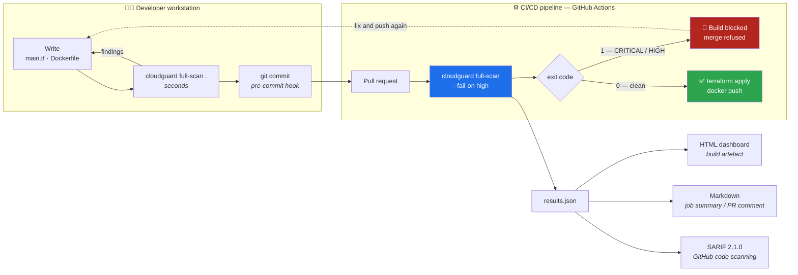

<div align="center">

# 🛡️ CloudGuard-IaC

**Shift-left security scanner for Infrastructure as Code and container images.**

*Catch the public S3 bucket, the `0.0.0.0/0` security group and the root container
in the pull request — not in the post-mortem.*

[](https://github.com/FlorianMartins/cloudguard-iac/actions/workflows/ci-cd.yml)
[](https://www.python.org)
[](LICENSE)
[](https://github.com/astral-sh/ruff)
[](https://mypy-lang.org/)
[](https://github.com/PyCQA/bandit)
[](#development)
[](https://docs.github.com/en/code-security/code-scanning)

</div>

---

## Table of contents

- [Why CloudGuard-IaC](#why-cloudguard-iac)
- [Quick start](#quick-start)
- [How it works](#how-it-works)
- [Installation](#installation)
- [Using the CLI](#using-the-cli)
- [Reports](#reports)
- [CI/CD integration](#cicd-integration)
- [Configuration](#configuration)
- [Security rules catalogue](#security-rules-catalogue)
- [The example corpus](#the-example-corpus)
- [Development](#development)
- [Roadmap](#roadmap)
- [Contributing](#contributing)
- [License](#license)

---

## Why CloudGuard-IaC

A misconfigured cloud resource is not a bug you find by testing the application. It is a
line of Terraform that nobody read carefully, merged on a Friday, and turned into a live
attack surface in ninety seconds.

The economics are brutal and well documented: a defect caught in code review costs a
comment; the same defect caught in production costs an incident, a rotation of every
credential involved, and — under the GDPR — a notification. **Shift-left security** means
moving that check to the earliest place where fixing it is still cheap: the developer's
terminal, then the pull request.

CloudGuard-IaC is the gate for that step. It is:

| | |
|---|---|
| 🔍 **A static analyser** | Reads Terraform (`.tf`, `.tfvars`) and Dockerfiles. Never contacts a cloud provider, never needs credentials, never runs `terraform plan`. |
| 🚦 **A CI/CD gate** | Exit code `1` as soon as a finding reaches the configured severity, so the pipeline stops before `terraform apply` or `docker push`. |
| 📚 **A teaching tool** | Every finding explains *why it is dangerous* and *how to fix it*, with a link to the vendor documentation or the CWE. |
| 📄 **A reporting engine** | Console, Markdown, HTML dashboard, JSON and **SARIF 2.1.0** for native GitHub code scanning alerts. |
| 🪶 **Dependency-light** | Two runtime dependencies (`typer`, `rich`). No Docker daemon, no Go toolchain, no cloud SDK. Installs in seconds in any runner. |

**31 detection rules**, each with a stable identifier, a severity and a documented
remediation — [see the full catalogue](#security-rules-catalogue).

---

## Quick start

```bash
git clone https://github.com/FlorianMartins/cloudguard-iac.git
cd cloudguard-iac
python3 -m venv .venv && source .venv/bin/activate
pip install -e .

# The hardened reference passes…
cloudguard full-scan examples/secure          # exit code 0

# …and the vulnerable one blocks the build.
cloudguard full-scan examples/vulnerable      # exit code 1
```

```console
$ cloudguard scan-docker examples/vulnerable

🛡️  CloudGuard-IaC  v1.0.0  ·  1 file(s)  ·  0.01s

examples/vulnerable/Dockerfile
LINE  SEVERITY  RULE           RESOURCE                   ISSUE
  16  CRITICAL  CG_DOCKER_005  ENV DB_PASSWORD            DB_PASSWORD bakes a secret into the image layers
                                                          (readable via `docker history`)
  17  CRITICAL  CG_DOCKER_005  ENV AWS_SECRET_ACCESS_KEY  AWS_SECRET_ACCESS_KEY bakes a secret into the image layers
  18  CRITICAL  CG_DOCKER_005  ARG GITHUB_TOKEN           GITHUB_TOKEN embeds a recognisable credential in the image
   9  HIGH      CG_DOCKER_001  ubuntu:latest              no USER instruction: the container runs as root (uid 0)
  28  HIGH      CG_DOCKER_004  RUN                        a remote script is downloaded and piped straight into a shell
  45  HIGH      CG_DOCKER_003  EXPOSE 22                  port 22 (SSH) is exposed by the image
   9  MEDIUM    CG_DOCKER_002  ubuntu:latest              base image 'ubuntu:latest' uses the "latest" tag
  23  MEDIUM    CG_DOCKER_007  RUN                        sudo is installed or used inside the image
  31  MEDIUM    CG_DOCKER_006  ADD                        ADD downloads a remote artefact without integrity verification
  39  MEDIUM    CG_DOCKER_012  COPY                       the whole build context is copied into the image
  42  MEDIUM    CG_DOCKER_008  RUN                        files are made world-writable (chmod 777)
   9  LOW       CG_DOCKER_011  ubuntu:latest              the final stage declares no HEALTHCHECK
  23  LOW       CG_DOCKER_010  RUN                        apt-get install: --no-install-recommends is missing and the
                                                          apt lists are not removed
  23  LOW       CG_DOCKER_014  RUN                        apt upgrade/dist-upgrade makes the build non-reproducible
  34  LOW       CG_DOCKER_009  RUN pip install            unpinned Python package(s): boto3, flask, requests
  12  INFO      CG_DOCKER_013  MAINTAINER                 MAINTAINER is deprecated in favour of OCI labels

Summary  3 critical   3 high   5 medium   4 low   1 info

╭─────────────────────────────── ❌ FAILED ───────────────────────────────╮
│ 6 finding(s) at or above HIGH. This scan fails the build (exit code 1). │
╰─────────────────────────────────────────────────────────────────────────╯
```

---

## How it works

### Where it sits in the delivery chain



### Inside the tool

```
                    ┌──────────────────────────────────────────┐
   *.tf / *.tfvars  │  IaCScanner                              │
   ────────────────▶│    hcl.py → tokenizer → syntax tree      │──┐
                    │    module index (cross-file references)  │  │
                    │    17 structural rules                   │  │
                    └──────────────────────────────────────────┘  │
                                                                  ├──▶ ┌───────────┐
                    ┌──────────────────────────────────────────┐  │    │  Finding  │
   Dockerfile*      │  DockerScanner                           │  │    │  ───────  │
   ────────────────▶│    instruction model (continuations,     │──┘    │ rule_id   │
                    │    heredocs, build stages)               │       │ severity  │
                    │    14 instruction rules                  │       │ file:line │
                    └──────────────────────────────────────────┘       │ why / fix │
                                                                       └─────┬─────┘
                              ┌────────────────────────────────┐              │
                              │  Suppressions & filters        │◀─────────────┘
                              │  # cloudguard:ignore RULE_ID   │
                              │  --ignore / --exclude / config │
                              └───────────────┬────────────────┘
                                              ▼
                      ┌───────────────────────────────────────────────┐
                      │  Reporters: console · markdown · html         │
                      │             json · sarif                      │
                      └───────────────────┬───────────────────────────┘
                                          ▼
                          exit 0  ·  exit 1  ·  exit 2
```

### Step 1 — Terraform: parse, then reason on the structure

Regular expressions cannot tell an `ingress` block from an `egress` one, and they cannot
find the CIDR of a rule declared three levels deep. CloudGuard therefore ships its own
dependency-free **HCL2 parser** ([`cloudguard/scanners/hcl.py`](cloudguard/scanners/hcl.py)):

1. **Tokenising** — the source is walked character by character, handling quoted strings
   with escapes, `${…}` interpolations, heredocs (`<<EOT` and the indented `<<-EOT`), and
   the three comment styles (`#`, `//`, `/* */`).
2. **Building the tree** — a recursive-descent pass produces `Block` nodes (type, labels,
   attributes, children, **source line**) and `Value` nodes. Each value keeps both its raw
   expression and, when it is a constant, its Python literal. `password = var.db_password`
   is therefore *unknown*, never *empty* — which is what stops the secret rule from firing
   on a correct configuration.
3. **Indexing the module** — since AWS provider v4, a bucket's encryption, versioning,
   logging and public-access block are **separate resources that reference it**, often in
   another file. All files given to one scan are parsed together and indexed, so a bucket
   declared in `s3.tf` is validated against the `aws_s3_bucket_public_access_block`
   declared in `security.tf`.
4. **Applying the rules** — each rule walks the tree. Severity can be raised or lowered by
   context: an ingress rule open to `0.0.0.0/0` is **CRITICAL** on port 22 (`CG_IAC_005`)
   and **HIGH** on port 8080 (`CG_IAC_006`), because the exploitation cost is not the same.
5. **Resolving policies** — IAM documents written as `jsonencode({…})`, as raw JSON in a
   heredoc, or as an `aws_iam_policy_document` data source are all normalised to the same
   structure before being checked for `Action: "*"` on `Resource: "*"`.

### Step 2 — Dockerfiles: normalise, then reason on the stages

[`cloudguard/scanners/docker_scanner.py`](cloudguard/scanners/docker_scanner.py) turns the
file into logical instructions — comments dropped, `\` continuations joined, `RUN <<EOF`
heredocs absorbed, `# escape=` directive honoured — while keeping every original line
number. Instructions are then grouped into **build stages**.

That last point is what separates a useful scanner from a noisy one: only the final stage
is published, so `USER root` in a builder stage is irrelevant, while a missing `USER` in
the final stage is a real HIGH finding. `FROM base AS runtime` is followed back through
the stage chain to find the effective user.

Command rules then work on the normalised text: `curl … | sh`, `chmod 777`, `apt-get
install` without cleanup, unpinned `pip install`, credentials in `ENV`/`ARG`, and known
credential shapes (`AKIA…`, `ghp_…`, PEM private keys) wherever they appear.

### Step 3 — Verdict and exit code

| Exit code | Meaning | Typical use |
|---:|---|---|
| **0** | Scan completed, nothing at or above the threshold | The pipeline continues |
| **1** | At least one finding at or above `--fail-on` (default `HIGH`) | The pipeline stops |
| **2** | Usage or runtime error (path not found, unreadable config, unwritable report) | A pipeline bug, not a security one |

Severity levels are `CRITICAL > HIGH > MEDIUM > LOW > INFO`. `--fail-on never` reports
everything and always exits 0 — the right setting for a first rollout on a legacy
codebase, or for a report-only job.

---

## Installation

### Requirements

- **Python 3.10+** (tested on 3.10, 3.11, 3.12 and 3.13)
- `pip` — nothing else. No Docker daemon, no Terraform binary, no cloud credentials.

### From the repository (recommended while the package is not on PyPI)

```bash
git clone https://github.com/FlorianMartins/cloudguard-iac.git
cd cloudguard-iac

python3 -m venv .venv
source .venv/bin/activate          # Windows: .venv\Scripts\activate

pip install -e .                   # editable install, `cloudguard` on the PATH
cloudguard --version
```

### With the development tooling

```bash
pip install -e ".[dev]"            # pytest, ruff, mypy, bandit, pip-audit, build
make check                         # lint + types + tests + SAST + self-scan
```

### Straight from Git, without cloning

```bash
pip install "cloudguard-iac @ git+https://github.com/FlorianMartins/cloudguard-iac@main"
```

### As a container

```bash
docker build -t cloudguard-iac .
docker run --rm -v "$PWD:/scan:ro" cloudguard-iac full-scan /scan
```

The image is multi-stage, runs as uid `10001` and ships no build tooling — and it is
scanned by CloudGuard itself on every commit.

---

## Using the CLI

```console
$ cloudguard --help

 Usage: cloudguard [OPTIONS] COMMAND [ARGS]...

 🛡️  CloudGuard-IaC — shift-left security scanner for Terraform and container images.

╭─ Commands ──────────────────────────────────────────────────────────────────────╮
│ scan-iac          Scan Terraform files (.tf, .tfvars) for misconfigurations.     │
│ scan-docker       Scan Dockerfiles for insecure build and runtime practices.     │
│ full-scan         Run every scanner (Terraform + Docker) over the given paths.   │
│ generate-report   Render a stored JSON result as HTML, Markdown, SARIF or text.  │
│ rules             List the detection rules shipped with CloudGuard.             │
╰─────────────────────────────────────────────────────────────────────────────────╯
```

### Options shared by the three scan commands

| Flag | Default | Description |
|---|---|---|
| `PATHS...` | `.` | Files or directories to scan (repeatable) |
| `-f`, `--fail-on` | `high` | `critical`, `high`, `medium`, `low`, `info` or `never` |
| `-F`, `--format` | `text` | `text`, `json`, `markdown`, `html`, `sarif` |
| `-o`, `--output` | — | Write the report to a file (the extension is added if missing) |
| `-i`, `--ignore` | — | Rule id to ignore, repeatable (`-i CG_IAC_015 -i CG_IAC_017`) |
| `-e`, `--exclude` | — | Path pattern to skip, repeatable (`-e 'legacy/**'`) |
| `-d`, `--details` | off | Print the impact and the remediation under each finding |
| `-q`, `--quiet` | off | Print nothing; rely on the exit code |
| `-c`, `--config` | auto | Path to `.cloudguard.toml` (searched upwards by default) |
| `--no-config` | off | Ignore any configuration file |
| `--no-color` | off | Disable colours — useful in logs that do not render ANSI |

### Everyday commands

```bash
# Terraform only, with the impact and the fix under each finding
cloudguard scan-iac infrastructure/ --details

# Dockerfiles only, stricter: MEDIUM findings block too
cloudguard scan-docker services/ --fail-on medium

# Everything, ignoring a rule the team consciously accepted
cloudguard full-scan . --ignore CG_IAC_015 --exclude 'examples/vulnerable'

# Report-only mode for a first pass on a legacy repository
cloudguard full-scan . --fail-on never --details

# Machine-readable output, piped into jq
cloudguard full-scan . -F json | jq '.findings[] | select(.severity=="CRITICAL")'

# Scan a single file
cloudguard scan-iac infrastructure/network/main.tf
```

### `generate-report` — scan once, publish everywhere

```bash
cloudguard full-scan . -F json -o reports/results.json --fail-on never

cloudguard generate-report -I reports/results.json -F html     -o reports/report.html
cloudguard generate-report -I reports/results.json -F markdown -o reports/report.md
cloudguard generate-report -I reports/results.json -F sarif    -o reports/report.sarif
```

The JSON result is the single source of truth: the same scan feeds the human dashboard,
the pull-request comment and the code-scanning upload, with no risk of three artefacts
disagreeing.

### `rules` — the catalogue, from the terminal

```console
$ cloudguard rules --category docker --severity high

                      CloudGuard-IaC — 4 detection rules
┏━━━━━━━━━━━━━━━┳━━━━━━━━━━┳━━━━━━━━━━┳━━━━━━━━━━━━━━━━━━━━━━━━━━━━━━━━━━━━━━━┓
┃ ID            ┃ SEVERITY ┃ CATEGORY ┃ TITLE                                 ┃
┡━━━━━━━━━━━━━━━╇━━━━━━━━━━╇━━━━━━━━━━╇━━━━━━━━━━━━━━━━━━━━━━━━━━━━━━━━━━━━━━━┩
│ CG_DOCKER_001 │ HIGH     │ docker   │ Container runs as root                │
│ CG_DOCKER_003 │ HIGH     │ docker   │ Dangerous administration port exposed │
│ CG_DOCKER_004 │ HIGH     │ docker   │ Remote script piped into a shell      │
│ CG_DOCKER_005 │ CRITICAL │ docker   │ Secret baked into the image           │
└───────────────┴──────────┴──────────┴───────────────────────────────────────┘
```

```bash
cloudguard rules -F json      # the whole registry, for tooling
cloudguard rules -F markdown  # the exact table published below
```

---

## Reports

### HTML — a self-contained dashboard

`cloudguard full-scan . -F html -o report.html` produces **one file with no external
dependency**: the CSS and the JavaScript are inlined, no CDN is contacted, no font is
downloaded. It opens from a build artefact on a machine with no Internet access, which is
exactly where these reports get read.

```
┌──────────────────────────────────────────────────────────────────────────┐
│ 🛡️ CloudGuard-IaC — security report                                      │
│ Target examples/vulnerable · 2 files · 0.02s · v1.0.0                    │
├──────────────────────────────────────────────────────────────────────────┤
│ ❌ Build blocked — 21 finding(s) at or above HIGH                        │
├──────────┬──────────┬──────────┬──────────┬──────────┬──────────────────┤
│  37      │  11      │  10      │   8      │   7      │   1              │
│  TOTAL   │ CRITICAL │  HIGH    │ MEDIUM   │  LOW     │ INFO             │
├──────────┴──────────┴──────────┴──────────┴──────────┴──────────────────┤
│ [ Filter by rule, file, resource…            ]  Click a card to filter   │
├──────────────────────────────────────────────────────────────────────────┤
│ examples/vulnerable/main.tf                                        20    │
│ ▸ CRITICAL CG_IAC_001  S3 bucket exposed through a public ACL   :58      │
│ ▾ CRITICAL CG_IAC_005  Security group open on an admin port     :76      │
│      acl = "public-read"                                                 │
│      Resource  aws_security_group.web                                    │
│      Issue     ingress from 0.0.0.0/0 reaches 22/SSH                     │
│      Why       An ingress rule allowing 0.0.0.0/0 on SSH exposes the …   │
│      Fix       Restrict cidr_blocks to your corporate ranges or a …      │
│      Refs      https://docs.aws.amazon.com/vpc/…                         │
└──────────────────────────────────────────────────────────────────────────┘
```

Severity cards act as filters, a search box narrows the list live, and the page follows the
reader's light/dark preference.

### Markdown — for pull requests and job summaries

Summary table, findings grouped by file, then a collapsible `<details>` block per finding
with the impact, the fix and the references. Piped straight into `$GITHUB_STEP_SUMMARY`,
it turns the CI job page into the security report.

### JSON — for tooling

```json
{
  "schema": "cloudguard.scan-result/v1",
  "tool_version": "1.0.0",
  "summary": {
    "total": 37,
    "files_scanned": 2,
    "by_severity": { "CRITICAL": 11, "HIGH": 10, "MEDIUM": 8, "LOW": 7, "INFO": 1 },
    "max_severity": "CRITICAL",
    "fail_on": "HIGH",
    "blocking": 21
  },
  "findings": [
    {
      "rule_id": "CG_IAC_005",
      "severity": "CRITICAL",
      "file": "examples/vulnerable/main.tf",
      "line": 76,
      "resource": "aws_security_group.web",
      "message": "ingress from 0.0.0.0/0 reaches 22/SSH",
      "remediation": "Restrict `cidr_blocks` to your corporate ranges or a bastion …",
      "why": "An ingress rule allowing `0.0.0.0/0` on SSH (22), RDP (3389) …",
      "references": ["https://docs.aws.amazon.com/vpc/latest/userguide/…"]
    }
  ]
}
```

### SARIF 2.1.0 — native GitHub alerts

Uploaded with `github/codeql-action/upload-sarif`, every finding becomes a code-scanning
alert annotated on the exact line of the diff, with its `security-severity` score, its
help text and its references — no custom bot, no extra permission beyond
`security-events: write`.

---

## CI/CD integration

### Minimal GitHub Actions job

```yaml
name: Security

on: [push, pull_request]

jobs:
  cloudguard:
    runs-on: ubuntu-latest
    steps:
      - uses: actions/checkout@v4
      - uses: actions/setup-python@v5
        with:
          python-version: "3.12"

      - name: Install CloudGuard-IaC
        run: pip install "cloudguard-iac @ git+https://github.com/FlorianMartins/cloudguard-iac@main"

      # Fails the job — and blocks the merge — on any CRITICAL or HIGH finding.
      - name: Scan the infrastructure code
        run: cloudguard full-scan . --fail-on high
```

### Complete job: gate, artefacts, summary and code scanning

```yaml
  cloudguard:
    runs-on: ubuntu-latest
    permissions:
      contents: read
      security-events: write        # required by upload-sarif
    steps:
      - uses: actions/checkout@v4
      - uses: actions/setup-python@v5
        with: { python-version: "3.12" }

      - run: pip install "cloudguard-iac @ git+https://github.com/FlorianMartins/cloudguard-iac@main"

      # 1. The gate — stops the pipeline on CRITICAL/HIGH
      - name: Security gate
        run: cloudguard full-scan . --fail-on high

      # 2. The artefacts — produced even when the gate failed
      - name: Reports
        if: always()
        run: |
          cloudguard full-scan . -F json -o reports/results.json --fail-on never
          cloudguard generate-report -I reports/results.json -F html  -o reports/report.html  --fail-on never
          cloudguard generate-report -I reports/results.json -F sarif -o reports/report.sarif --fail-on never
          cloudguard generate-report -I reports/results.json -F markdown --fail-on never >> "$GITHUB_STEP_SUMMARY"

      - name: Publish the reports
        if: always()
        uses: actions/upload-artifact@v4
        with: { name: cloudguard-reports, path: reports/ }

      - name: Publish the alerts
        if: always()
        uses: github/codeql-action/upload-sarif@v3
        with: { sarif_file: reports/report.sarif, category: cloudguard-iac }
```

> **Note** — `generate-report` also honours `--fail-on`, so pass `--fail-on never` on the
> reporting steps: you want them to produce artefacts, not to fail a second time.

### Reusable composite action

This repository ships a ready-made action in
[`.github/actions/cloudguard`](.github/actions/cloudguard/action.yml):

```yaml
      - uses: FlorianMartins/cloudguard-iac/.github/actions/cloudguard@main
        id: security
        with:
          path: infrastructure/
          scanner: full-scan        # or scan-iac / scan-docker
          fail-on: high
          format: json
          output: cloudguard-report.json
          ignore: "CG_IAC_015"
          exclude: "legacy/** examples/**"
          summary: "true"           # append the Markdown report to the job page

      - run: echo "Findings: ${{ steps.security.outputs.total }}"
```

### GitLab CI

```yaml
cloudguard:
  stage: test
  image: python:3.12-slim
  before_script:
    - pip install "cloudguard-iac @ git+https://github.com/FlorianMartins/cloudguard-iac@main"
  script:
    - cloudguard full-scan . --fail-on high -F json -o cloudguard.json
  artifacts:
    when: always
    paths: [cloudguard.json]
    expire_in: 30 days
```

### Local pre-commit hook

```yaml
# .pre-commit-config.yaml
repos:
  - repo: local
    hooks:
      - id: cloudguard
        name: CloudGuard-IaC
        entry: cloudguard full-scan
        language: system
        pass_filenames: false
        files: \.(tf|tfvars)$|(^|/)Dockerfile
```

### Rollout advice

Turning a strict gate on an existing repository floods the first pull request. What works:

1. **Week 1 — observe.** `--fail-on never`, publish the HTML report as an artefact.
2. **Week 2 — block the worst.** `--fail-on critical`, so only the indefensible stops a merge.
3. **Week 4 — the real gate.** `--fail-on high`, the default.
4. **Then, the exceptions.** Each accepted risk becomes an inline
   `# cloudguard:ignore CG_IAC_015 <reason>` — reviewable in the diff — rather than a rule
   silently disabled for the whole repository.

---

## Configuration

### `.cloudguard.toml`

Dropped at the root of the repository (or in any parent directory of the scanned path), it
gives the team one shared verdict — the developer's terminal and the CI runner agree
because they read the same file. **Command line flags always win.**

```toml
[cloudguard]
# Severity that fails the command: CRITICAL, HIGH, MEDIUM, LOW, INFO or "never".
fail_on = "HIGH"

# Rules the team consciously accepts, repository-wide.
ignore = ["CG_IAC_015"]     # access logging is handled by CloudTrail data events

# Paths never scanned.
exclude = ["examples/vulnerable", "legacy/"]
```

### Inline suppressions

The finer-grained — and reviewable — way to accept a risk: the justification lives next to
the code, and it shows up in the diff.

```hcl
# The log destination bucket cannot log into itself without creating a loop.
# cloudguard:ignore CG_IAC_015 log bucket, self-logging would loop
resource "aws_s3_bucket" "access_logs" {
  bucket = "acme-access-logs"
}
```

| Form | Effect |
|---|---|
| `# cloudguard:ignore CG_IAC_001` | Suppresses that rule on the directive's line and the next one |
| `# cloudguard:ignore CG_IAC_001, CG_IAC_002` | Several rules at once |
| `# cloudguard:ignore` | Every rule, on that line only |
| `# cloudguard:ignore-file` | Every rule of the whole file |

Suppressed findings are counted and displayed (`3 finding(s) suppressed by inline
directives`): silencing a rule stays visible, it never disappears.

---

## Security rules catalogue

**31 rules** — 17 for Terraform, 14 for Dockerfiles.

> This table is **generated from [`cloudguard/rules.py`](cloudguard/rules.py)** by
> `scripts/sync_rules_table.py`, and the `docs` job of the CI pipeline fails if the two
> ever disagree. Documentation that is generated cannot drift.

<!-- BEGIN RULES TABLE (generated by scripts/sync_rules_table.py) -->

| Rule | Severity | Target | What it detects | Why it is dangerous | Remediation |
| --- | --- | --- | --- | --- | --- |
| `CG_DOCKER_001` | **HIGH** | docker | Container runs as root | Without a `USER` instruction the process runs as uid 0. Any RCE in the application starts with root inside the container, which makes kernel and runtime escapes far easier and lets the attacker write to mounted volumes. | Create a dedicated unprivileged account (`RUN adduser --system --uid 10001 app`) and end the final stage with `USER app` (or a numeric uid, required by some Kubernetes `runAsNonRoot` policies). |
| `CG_DOCKER_002` | **MEDIUM** | docker | Base image not pinned to an immutable tag | `latest` (or no tag at all) means the image you tested is not the image you ship: builds are irreproducible, a supply-chain compromise of the upstream tag is invisible, and rollbacks stop being meaningful. | Pin an explicit version and ideally a digest: `FROM python:3.12-slim@sha256:…`, refreshed by Dependabot or Renovate. |
| `CG_DOCKER_003` | **HIGH** | docker | Dangerous administration port exposed | Exposing SSH (22), RDP (3389), Telnet (23) or the Docker daemon socket (2375/2376) from a container multiplies the attack surface; 2375 in particular is unauthenticated root-equivalent access to the host. | Remove the `EXPOSE` line and use `docker exec`/`kubectl exec` for debugging. Never publish the daemon port from inside an image. |
| `CG_DOCKER_004` | **HIGH** | docker | Remote script piped into a shell | `curl … \| sh` executes whatever the server returns at build time, with no signature and no integrity check. A compromised — or simply hijacked — URL means arbitrary code baked into your image. | Download to a file, verify a checksum or a signature, then execute. Better: install from the distribution package manager or a pinned release artefact. |
| `CG_DOCKER_005` | **CRITICAL** | docker | Secret baked into the image | `ENV`/`ARG` values are stored in the image metadata and readable with `docker history` by anyone who can pull the image — including from a public registry. Deleting the secret in a later layer does not remove it. | Inject secrets at runtime (environment injected by the orchestrator, mounted file) or at build time with BuildKit secret mounts: `RUN --mount=type=secret,id=token …`. |
| `CG_DOCKER_006` | **MEDIUM** | docker | ADD used with a remote URL | `ADD http://…` fetches an unverified remote artefact and silently auto-extracts archives, which has historically enabled path-traversal (zip-slip) style attacks. | Use `COPY` for local files, and `RUN curl -fsSL … && echo "<sha256>  file" \| sha256sum -c -` when a download is unavoidable. |
| `CG_DOCKER_007` | **MEDIUM** | docker | Privilege escalation tooling installed | Shipping `sudo` — or worse, a passwordless sudoers entry — inside an image gives any code execution a ready-made path back to root, defeating the `USER` directive. | Do the privileged work in build stages that run as root, then drop to an unprivileged `USER` for the runtime stage. Do not install `sudo`. |
| `CG_DOCKER_008` | **MEDIUM** | docker | World-writable permissions applied | `chmod 777` (or `chmod -R 777`) lets any process in the container — including a compromised low-privilege one — rewrite application code and binaries, turning a read primitive into persistence. | Grant the minimum required mode (`chmod 750`, `chmod 640`) and set ownership with `COPY --chown=app:app`. |
| `CG_DOCKER_009` | **LOW** | docker | Package installed without version pinning | Unpinned `pip install`/`npm install` resolves to whatever version exists at build time: builds drift, and a malicious release published upstream lands straight in your image. | Pin versions and hashes: `pip install -r requirements.txt --require-hashes`, `npm ci` with a committed lockfile. |
| `CG_DOCKER_010` | **LOW** | docker | Package manager cache left in the image | Leftover apt/apk indexes and recommended packages inflate the image and ship extra binaries that show up as CVEs and give an attacker more tools to work with. | Chain `apt-get install --no-install-recommends` with `rm -rf /var/lib/apt/lists/*` in the same `RUN`, or use `apk add --no-cache`. |
| `CG_DOCKER_011` | **LOW** | docker | Missing HEALTHCHECK instruction | Without a health check the orchestrator cannot tell a hung or half-compromised container from a healthy one, so a failing workload keeps receiving traffic. | Add a lightweight `HEALTHCHECK CMD` probing a real endpoint, with sensible `--interval` and `--timeout` values. |
| `CG_DOCKER_012` | **MEDIUM** | docker | Whole build context copied into the image | `COPY . .` ships everything the build context contains — `.git`, `.env`, private keys, CI configuration — unless a `.dockerignore` excludes it. Secrets leak into layers this way constantly. | Copy only what the runtime needs (`COPY src/ ./src/`) and always commit a `.dockerignore` covering `.git`, `.env`, `*.pem` and local tooling. |
| `CG_DOCKER_013` | **INFO** | docker | Deprecated or superseded instruction | `MAINTAINER` has been deprecated since Docker 1.13; it is not read by modern tooling, so ownership information is lost when it matters (during an incident). | Replace it with an OCI label: `LABEL org.opencontainers.image.authors="team@example.com"`. |
| `CG_DOCKER_014` | **LOW** | docker | Blanket distribution upgrade at build time | `apt-get upgrade`/`dist-upgrade` inside a build makes the image content depend on the build date, so two builds of the same commit produce different — and differently vulnerable — images. | Rebuild on a freshly patched, pinned base image instead of upgrading in place, and let Dependabot/Renovate bump the base tag. |
| `CG_IAC_001` | **CRITICAL** | terraform | S3 bucket exposed through a public ACL | A `public-read` or `public-read-write` ACL makes every object in the bucket readable — and sometimes writable — by anyone on the Internet. This is the single most common root cause of cloud data leaks. | Drop the `acl` argument (buckets are private by default since AWS provider v4) or set it to `private`, and front the bucket with CloudFront + OAC when public distribution is genuinely required. |
| `CG_IAC_002` | **HIGH** | terraform | S3 bucket without a public access block | Without an `aws_s3_bucket_public_access_block` with all four flags enabled, a future ACL or bucket policy — added by a human or by another module — can silently make the bucket public. | Declare an `aws_s3_bucket_public_access_block` for the bucket with `block_public_acls`, `block_public_policy`, `ignore_public_acls` and `restrict_public_buckets` all set to `true`. |
| `CG_IAC_003` | **HIGH** | terraform | S3 bucket without server-side encryption | Objects stored without server-side encryption are readable by anyone who gets hold of the underlying storage or a stale backup, and the configuration fails most compliance baselines (PCI-DSS, HDS, ISO 27001). | Add an `aws_s3_bucket_server_side_encryption_configuration` resource using `aws:kms` with a customer-managed key, or at minimum `AES256`. |
| `CG_IAC_004` | **MEDIUM** | terraform | S3 bucket without versioning | Without versioning, an accidental deletion or a ransomware-style overwrite is irreversible: there is no previous object version to restore. | Add an `aws_s3_bucket_versioning` resource with `versioning_configuration { status = "Enabled" }`. |
| `CG_IAC_005` | **CRITICAL** | terraform | Security group open to the world on an administration port | An ingress rule allowing `0.0.0.0/0` on SSH (22), RDP (3389), a database port or an orchestrator API exposes the instance to permanent Internet-wide credential stuffing and to any future CVE on that service. | Restrict `cidr_blocks` to your corporate ranges or a bastion security group, and prefer AWS Systems Manager Session Manager over inbound SSH/RDP altogether. |
| `CG_IAC_006` | **HIGH** | terraform | Security group ingress open to the world | Ingress from `0.0.0.0/0` (or `::/0`) removes the network layer from your defence in depth: the application is the only thing left between the Internet and your data. | Scope `cidr_blocks` to known networks, or reference a `source_security_group_id` so that only peer workloads can reach the port. |
| `CG_IAC_007` | **HIGH** | terraform | Security group allowing every port or every protocol | `protocol = "-1"` or a `0-65535` port range turns the security group into a no-op: any service accidentally bound on the host becomes reachable. | Declare one ingress rule per port actually needed, with an explicit protocol. |
| `CG_IAC_008` | **HIGH** | terraform | Unencrypted block storage volume | An unencrypted EBS volume or snapshot leaks its full content to anyone able to attach it, restore it, or read the underlying storage — including a snapshot shared by mistake. | Set `encrypted = true` and reference a KMS key with `kms_key_id`; enable EBS encryption by default at the account level. |
| `CG_IAC_009` | **HIGH** | terraform | Unencrypted managed database | An RDS instance or cluster without `storage_encrypted` writes your business data and its automated backups in clear text. Encryption cannot be enabled in place later — it requires a full snapshot/restore migration. | Set `storage_encrypted = true` (and `kms_key_id`) at creation time. |
| `CG_IAC_010` | **CRITICAL** | terraform | Publicly accessible managed database | `publicly_accessible = true` gives the database a public IP address. Combined with a permissive security group it is directly exploitable, and it is a favourite target of automated scanners. | Set `publicly_accessible = false` and reach the database from private subnets, through a VPN, a bastion or VPC peering. |
| `CG_IAC_011` | **CRITICAL** | terraform | Hardcoded secret in Terraform code | A password, API key or token written in a `.tf` file is committed to Git forever, readable by everyone with repository access, and copied into every clone, fork and CI cache. Rotating it after the fact is the only remedy. | Move the value to a secret manager (AWS Secrets Manager, SSM Parameter Store, Vault) and inject it via a data source, or use a variable marked `sensitive = true` fed by the CI secret store. |
| `CG_IAC_012` | **HIGH** | terraform | IAM policy granting wildcard permissions | `Action: "*"` on `Resource: "*"` is an administrator grant. Any compromise of the attached identity becomes a full account takeover, and it defeats every blast-radius assumption made elsewhere. | Apply least privilege: enumerate the API actions actually used and scope resources to explicit ARNs. Use IAM Access Analyzer to generate the policy from CloudTrail history. |
| `CG_IAC_013` | **MEDIUM** | terraform | EC2 instance allowing IMDSv1 | IMDSv1 answers unauthenticated GET requests, so a single SSRF in the application is enough to steal the instance role credentials — the exact pattern behind the 2019 Capital One breach. | Add `metadata_options { http_tokens = "required", http_endpoint = "enabled" }` to enforce IMDSv2 (session-oriented, PUT-authenticated). |
| `CG_IAC_014` | **MEDIUM** | terraform | Managed database without backup retention | `backup_retention_period = 0` disables automated backups and point-in-time recovery: a corruption, a bad migration or a ransomware event is unrecoverable. | Set `backup_retention_period` to at least 7 days and test the restore procedure. |
| `CG_IAC_015` | **LOW** | terraform | S3 bucket without access logging | Without server access logs there is no forensic trail: after an incident you cannot tell which objects were read or by whom. | Add an `aws_s3_bucket_logging` resource pointing at a dedicated log bucket, or enable CloudTrail data events for the bucket. |
| `CG_IAC_016` | **LOW** | terraform | Sensitive variable not marked as sensitive | A variable named after a secret but without `sensitive = true` is echoed in plan output, in CI logs and in the state diff, leaking the value to anyone reading the job. | Add `sensitive = true` to the variable declaration. |
| `CG_IAC_017` | **LOW** | terraform | Unrestricted egress to the Internet | Wide-open egress lets a compromised workload exfiltrate data and reach its command and control server. Egress filtering is what turns a foothold into a dead end. | Restrict egress to the destinations the workload needs, and route the rest through VPC endpoints or an inspection proxy. |

<!-- END RULES TABLE -->

---

## The example corpus

`examples/` holds two mirrored deployments of the same fictional application — the same
bucket, the same security groups, the same database, the same image:

| | `examples/vulnerable/` | `examples/secure/` |
|---|---|---|
| **Purpose** | Trigger every rule in the catalogue | Pass every rule in the catalogue |
| **Terraform** | Public bucket, SSH open to the world, unencrypted and public database, `Action: "*"`, credentials in clear | Private encrypted versioned bucket, ingress through a bastion, encrypted private database with backups, scoped IAM, secrets from the vault |
| **Dockerfile** | `ubuntu:latest`, root, `curl \| bash`, secrets in `ENV`, `EXPOSE 22` | Multi-stage, pinned base image, uid `10001`, verified dependencies, `HEALTHCHECK` |
| **Scan result** | 37 findings — **exit 1** | 0 findings — **exit 0** |

The pair is also the regression net: [`tests/test_examples.py`](tests/test_examples.py)
asserts that **every one of the 31 rules fires on the vulnerable corpus and none fires on
the secure one**. A rule that stops working, or starts crying wolf, fails the build.

Reading the two files side by side is the fastest way to learn what the tool checks:

```bash
diff -u examples/vulnerable/main.tf examples/secure/main.tf
```

---

## Development

```
cloudguard-iac/
├── cloudguard/
│   ├── cli.py                  # Typer entry point, exit codes, output routing
│   ├── engine.py               # discovery, scanner dispatch, result assembly
│   ├── models.py               # Severity, Finding, ScanResult
│   ├── rules.py                # the rule registry — single source of truth
│   ├── config.py               # .cloudguard.toml
│   ├── scanners/
│   │   ├── hcl.py              # dependency-free HCL2 parser
│   │   ├── iac_scanner.py      # 17 Terraform rules
│   │   ├── docker_scanner.py   # 14 Dockerfile rules
│   │   └── base.py             # file matching, inline suppressions
│   └── reporters/
│       ├── console_reporter.py # Rich terminal output
│       ├── markdown_reporter.py
│       ├── html_reporter.py    # self-contained dashboard
│       └── sarif_reporter.py   # SARIF 2.1.0
├── examples/{vulnerable,secure}/
├── tests/                      # 399 tests, 90% coverage
├── scripts/sync_rules_table.py
├── .github/workflows/ci-cd.yml
├── .github/actions/cloudguard/ # reusable composite action
└── Dockerfile                  # the tool's own image, scanned by itself
```

### Make targets

```bash
make install     # virtualenv + editable install with the dev extras
make lint        # ruff check + ruff format --check
make typecheck   # mypy --strict
make test        # pytest with coverage
make sast        # bandit + pip-audit on our own code
make selfscan    # CloudGuard scanning this repository
make demo        # the vulnerable corpus (fails on purpose)
make reports     # generate the HTML, Markdown and SARIF reports
make docs        # regenerate the rules table in this README
make check       # everything the CI pipeline checks
```

### Quality bar

Every gate below runs on every commit and every pull request:

- **`ruff`** — lint (including `flake8-bandit`, `bugbear`, `pydocstyle`) and formatting
- **`mypy --strict`** — no untyped definition, no implicit `Any`
- **`pytest`** — 399 tests, 90% coverage, on Python 3.10 → 3.13
- **`bandit` + `pip-audit`** — SAST on our own source and on the dependency tree
- **CloudGuard itself** — the repository, its `Dockerfile` and the hardened examples must
  scan clean; the vulnerable corpus must return exit code 1

### Adding a rule

1. Declare it in [`cloudguard/rules.py`](cloudguard/rules.py) — id, severity, category,
   `why` (the impact, not a restatement of the title) and `remediation` (actionable).
2. Implement the detection in the relevant scanner, returning `self.finding("CG_…", …)`.
3. Add the vulnerable pattern to `examples/vulnerable/` and its fix to `examples/secure/`.
4. Add a rule-level test in `tests/test_iac_scanner.py` or `tests/test_docker_scanner.py`,
   covering **both** the positive and the negative case — a rule with no negative test is
   a future false positive.
5. `make docs` to refresh the README table, then `make check`.

The registry tests enforce the rest: unique and contiguous ids, an id prefix matching the
category, a `why` longer than a slogan, an actionable `remediation`, `https` references,
and — the strictest one — every declared rule must fire on the vulnerable corpus.

---

## Roadmap

- [ ] Publish to PyPI and to the GitHub Marketplace
- [ ] Kubernetes manifests and Helm charts (`CG_K8S_*`)
- [ ] CloudFormation and Azure Bicep
- [ ] Terraform plan JSON as an input, to resolve variables and modules
- [ ] `--baseline results.json` to report only what a pull request introduces
- [ ] Custom rules loaded from the repository (`.cloudguard/rules/*.py`)
- [ ] Auto-fix for the mechanical rules (`--fix`)

---

## Contributing

Contributions are welcome — a new rule, a false positive to kill, a clearer remediation.

```bash
git clone https://github.com/FlorianMartins/cloudguard-iac.git
cd cloudguard-iac
make install
make check          # must be green before opening a pull request
```

Read [CONTRIBUTING.md](CONTRIBUTING.md) for the conventions, and
[SECURITY.md](SECURITY.md) to report a vulnerability in the tool itself.

**False positives are bugs.** A security tool that cries wolf gets ignored, and an ignored
tool protects nothing. Open an issue with the smallest snippet that reproduces it.

---

## License

[MIT](LICENSE) © 2026 Florian Martins

---

<div align="center">
<sub>Built as a DevSecOps portfolio project — <b>shift left, fail fast, fix cheap.</b></sub>
</div>
